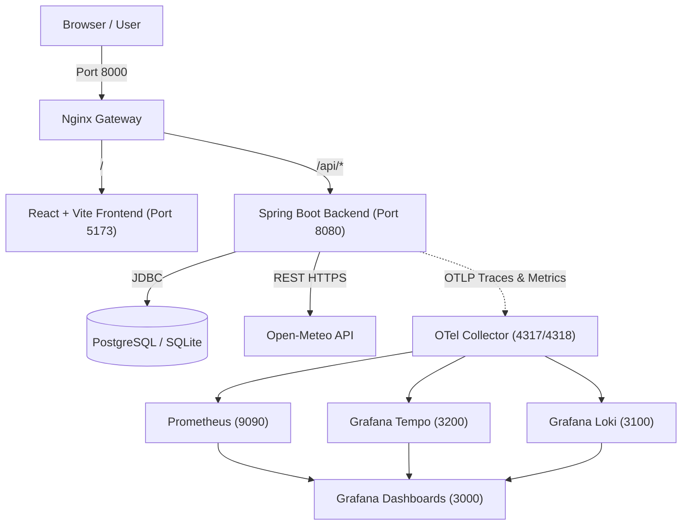

# Weather Analytics Dashboard (Sunny Insights)

> A modern, full-stack weather intelligence and analytics platform designed to collect, analyze, compare, and visualize historical and forecasted meteorological data across global cities.

[](https://github.com/mykola-lp/ai-dev-tools-zoomcamp/actions/workflows/ci.yml)
[](LICENSE)

---

## Part 1: What is this project?

### 1. Title and Description

**Weather Analytics Dashboard** (internally codenamed *Sunny Insights*) is a production-ready, full-stack web application for interactive weather intelligence. It aggregates weather data via upstream providers, calculates statistical aggregates, trends, and anomalies through a pure analytical engine, and serves both anonymous visitors and authenticated users with customizable, shareable dashboards.

The project was constructed as an end-to-end demonstration of **AI-native software engineering**, evolving iteratively from initial specification through automated deployment, end-to-end testing, and complete OpenTelemetry observability.

### 2. Problem

Most consumer weather interfaces present only ephemeral, point-in-time forecasts for a single location. Engineers, researchers, travelers, and event planners frequently need:
- **Multi-city comparisons** across identical meteorological metrics over standardized time windows.
- **Historical trend detection and anomaly analysis** (e.g., standard deviation deviations, unseasonal temperature spikes).
- **Persistent, shareable views** without vendor lock-in or client-side API key exposure.
- **Resilient caching** that shields external rate limits and avoids unnecessary upstream provider costs.

This application solves these challenges by encapsulating upstream weather providers behind a robust backend caching and analysis engine, delivering sub-second response times through an adaptive client interface.

### 3. Demo & Key Features

- **Public & Anonymous Exploration:** Instant search and map-based selection across global cities, time periods, and weather metrics without requiring an account.
- **Multi-City Comparison:** Side-by-side metric charts, heatmaps, and textual insights comparing multiple locations simultaneously.
- **Analytical Insights:** Automatic calculation of daily averages, temperature extremes, variance, trends, and meteorological anomalies.
- **Persistent Personal Dashboards:** Authenticated accounts can save reusable city collections, configure custom views (public or private), and preserve immutable analysis snapshot runs.
- **Adaptive UI:** Responsive layout built with React, Vite, TanStack Router, Lucide Icons, and Tailwind CSS.
- **Shared URLs:** Shareable links for public analytical views.

---

## Part 2: Does it work well?

### 1. Quality & Evaluation

Because this application relies on deterministic meteorological analytics rather than open-ended LLM generations, verification is anchored in strict contract validation and domain mathematics:
- **API Contract Compliance:** The backend strictly implements the OpenAPI 3.0 specification ([`openapi.yaml`](file:///home/amd/projects/ai-dev-tools-zoomcamp/02-development/openapi.yaml)).
- **Pure Analytics Engine:** The `AnalyticsEngine` module operates as pure, side-effect-free Java functions, rigorously tested against edge cases (zero variance, missing series, leap years, timezone offsets).
- **Snapshot Immutability:** Historical analysis runs are persisted as immutable JSON records to guarantee auditability even when upstream data or view settings change.

### 2. Testing Strategy

The repository follows a multi-tiered testing pyramid:

```
          / \
         / E2E \        Playwright (Chromium browser automation)
        /-------\
       / Integr. \      Vitest (Full HTTP API & database integration)
      /-----------\
     / Unit / Slice\    JUnit 5, Mockito, Vitest, React Testing Library
    /---------------\
```

| Suite | Scope & Tools | Command |
|---|---|---|
| **Backend Unit** | Service logic, analytics, security, Spring Data JPA slices | `make test-be` (`./mvnw -B test`) |
| **Frontend Unit** | React components, hooks, UI state, Vitest | `make test-fe` (`npm test`) |
| **Integration** | Live backend against SQLite/Postgres endpoints (`:19080`) | `make integration` (`npx vitest run`) |
| **End-to-End (E2E)** | Full user workflows in Chromium via Playwright | `make e2e` (`npx playwright test`) |

To run the complete automated test suite locally:
```bash
make test
make integration
make e2e
```

### 3. Monitoring & Observability

The application implements full production-grade observability via the **OpenTelemetry (OTel)** ecosystem:

- **Distributed Tracing:** Incoming HTTP requests propagate trace contexts through Nginx, the Spring Boot backend, and out to Open-Meteo queries, exported via OTLP to **Grafana Tempo**.
- **Application Metrics:** JVM, HTTP throughput, database connection pool statistics, and cache hit ratios scraped by **Prometheus**.
- **Centralized Logging:** Structured logs forwarded to **Grafana Loki**.
- **Grafana Dashboards:** Pre-provisioned dashboards located in [`observability/grafana/`](file:///home/amd/projects/ai-dev-tools-zoomcamp/02-development/observability/grafana/).

To launch the observability cluster:
```bash
cd observability
docker compose up -d
```
Access Grafana at [http://localhost:3000](http://localhost:3000) (User: `admin`, Pass: `admin`).

---

## Part 3: Can I run and reproduce it?

### 1. Quickstart

#### Prerequisites
- **Docker** & **Docker Compose** (v2+)
- **GNU Make**
- Optional for bare-metal development: JDK 21+ and Node.js 22+

#### Option A: Quickstart via Docker Compose (Recommended)
Clone the repository and run:
```bash
cd 02-development
make docker-run
```
Once healthy, navigate to:
- **Application UI:** [http://localhost:8000](http://localhost:8000) (via Nginx gateway)
- **Direct Backend API:** [http://localhost:8080/api](http://localhost:8080/api)
- **Pre-seeded Demo User:** `demo@example.com` / `demo1234`

#### Option B: Bare-Metal Local Development
```bash
# Terminal 1: Run backend and frontend concurrently
make dev

# Or run separately:
make backend   # Starts Spring Boot on :8080 (SQLite weather.db)
make frontend  # Starts Vite dev server on :5173 with proxy
```

### 2. Data and Configuration

Configuration is managed via environment variables and Spring profiles:

| Variable | Default (Dev) | Description |
|---|---|---|
| `SPRING_PROFILES_ACTIVE` | `dev` | Profile (`dev` for SQLite, `prod` for PostgreSQL) |
| `SPRING_DATASOURCE_URL` | `jdbc:sqlite:weather.db` | Database connection URL |
| `OPEN_METEO_BASE_URL` | `https://api.open-meteo.com` | Upstream weather provider endpoint |
| `SEED_ENABLED` | `true` | Pre-populates 41 cities and demo user records |
| `OTEL_EXPORTER_OTLP_ENDPOINT`| `http://otel-collector:4318` | OpenTelemetry Collector endpoint |

Database migrations are automatically applied on startup using **Flyway** (`backend/src/main/resources/db/migration`).

### 3. Deployment

The stack is fully containerized with multi-stage `Dockerfile` configurations:
- **Frontend Container:** Multi-stage Node/Vite build serving static assets or proxying through Nginx.
- **Backend Container:** Multi-stage Eclipse Temurin JRE container running optimized Spring Boot fat JARs.
- **Reverse Proxy Gateway:** Nginx Alpine image routing `/api/*` to backend and root traffic to frontend.
- **Database:** PostgreSQL 17 Alpine in production mode with persistent Docker volumes.

To deploy or build production images:
```bash
make docker-build
make docker-run
```

---

## Part 4: How was it built?

### 1. Architecture



### 2. Project Structure

```
02-development/
├── backend/                  # Spring Boot 3.3 (Java 21) REST API
│   ├── src/main/java/        # Controllers, Services, Entities, Repositories, Analytics
│   ├── src/main/resources/   # Flyway migrations, application.properties
│   ├── Dockerfile            # Production multi-stage image
│   └── pom.xml               # Maven dependencies and build definitions
├── frontend/                 # React 18, Vite, TypeScript, Tailwind CSS
│   ├── src/                  # Routes, components, hooks, API services
│   ├── Dockerfile            # Production container image
│   └── package.json          # Node dependencies and scripts
├── observability/            # Full OTel monitoring stack
│   ├── grafana/              # Provisioned dashboards & datasources
│   ├── otel-collector-config.yaml
│   ├── prometheus.yml
│   └── docker-compose.yml    # Standalone monitoring composition
├── integration-tests/        # Vitest API integration tests
├── e2e/                      # Playwright browser end-to-end tests
├── docs/                     # Product requirements & specifications (spec.md)
├── openapi.yaml              # Contract-first OpenAPI specification
├── docker-compose.yml        # Production stack (Postgres, Backend, Frontend, Nginx)
├── docker-compose.dev.yml    # Development stack
├── docker-compose.ci.yml     # Automated testing overlay
├── Makefile                  # Developer workflow targets
└── AGENTS.md                 # Rules & coding instructions for AI agents
```

### 3. Decisions and Trade-offs

1. **Spring Boot 3.3 + Java 21 vs. Python/Node:** Chosen for enterprise-grade type safety, mature JPA ecosystem, and first-class OpenTelemetry auto-instrumentation.
2. **SQLite in Dev vs. PostgreSQL in Prod:** SQLite enables instantaneous zero-dependency local starts for developers; PostgreSQL provides concurrent transactional locking and connection pooling in production.
3. **Upstream Caching Layer:** Direct Open-Meteo queries are cached in the database with configurable TTLs. This avoids rate-limiting, handles temporary upstream outages, and ensures sub-20ms response times for repeat queries.
4. **Contract-First Design:** The application began with `openapi.yaml`, enabling frontend and backend development to proceed in parallel with automated integration tests verifying adherence.

### 4. CI/CD

Continuous Integration and Delivery is powered by GitHub Actions:
- [`.github/workflows/ci.yml`](file:///home/amd/projects/ai-dev-tools-zoomcamp/.github/workflows/ci.yml): Triggered on every pull request and push to `main` and `develop`. Executes Java compilation, backend tests, frontend tests, builds container images, and executes live integration + Playwright E2E suites.
- [`.github/workflows/build-dev.yml`](file:///home/amd/projects/ai-dev-tools-zoomcamp/.github/workflows/build-dev.yml): Builds and pushes dev images to GitHub Container Registry (GHCR).
- [`.github/workflows/promote-to-prod.yml`](file:///home/amd/projects/ai-dev-tools-zoomcamp/.github/workflows/promote-to-prod.yml): Manual workflow dispatch for zero-downtime release promotion to production tags.

---

## Part 5: Scope, Limitations, and Future Work

### 1. Limitations

- **Provider Dependency:** Weather data relies on Open-Meteo; failover to secondary providers (e.g., WeatherAPI, NOAA) is not yet implemented.
- **Historical Horizon:** In-memory demo datasets are capped to preserve lightweight storage during local runs.
- **Single-Node DB:** The production configuration utilizes a single PostgreSQL instance rather than a distributed read-replica cluster.

### 2. Future Work

- [ ] Multi-provider fallback strategy with automatic circuit breaker.
- [ ] Push notifications and webhook alerts for user-defined meteorological thresholds.
- [ ] Predictive LLM summary generation for natural language weather insights.
- [ ] Native mobile client via React Native sharing the existing service layer.

### 3. Self-Evaluation

| Rubric Criteria | Score | Evidence |
|---|:---:|---|
| **Problem Formulation & UX** | 5/5 | Complete, detailed specification (`docs/spec.md`) and intuitive responsive UI. |
| **Reproducibility** | 5/5 | Single-command reproduction (`make docker-run` / `make dev`) with zero friction. |
| **Testing Quality** | 5/5 | Full pyramid: unit, frontend component, API integration, and Playwright E2E. |
| **Observability** | 5/5 | Production OTel stack (Prometheus, Loki, Tempo, Grafana) with provisioned assets. |
| **CI/CD Automation** | 5/5 | Complete GitHub Actions matrix enforcing automated test gates before image publication. |

---

## 📌 Development Journey & Architectural Evolution Note

> **Note on Course Progression & Repository Organization:**
>
> This project was developed as part of the hands-on **AI Dev Tools Zoomcamp**, spanning four core instructional modules and articles:
>
> 1. **[Build and Ship an AI-Assisted Full-Stack App](https://aishippingblog.com/p/build-and-ship-a-full-stack-app-with)**: Initial specification, domain modeling, Spring Boot backend creation, React frontend scaffold, and Open-Meteo integration.
> 2. **[Deploy a Full-Stack App with AI Coding](https://aishippingblog.com/p/deploy-a-full-stack-app-with-ai-coding)**: Production containerization, multi-stage Dockerfiles, PostgreSQL migration, and Nginx reverse proxy configuration.
> 3. **[DevOps and Observability for an AI App](https://aishippingblog.com/p/devops-and-observability-for-an-ai)**: OpenTelemetry collector setup, metrics, distributed tracing via Tempo, structured logging via Loki, and GitHub Actions CI/CD with end-to-end Playwright tests.
> 4. **[Coding Agent Building Blocks: Reusable Instructions, Memory, and Skills](https://aishippingblog.com/p/coding-agent-building-blocks-reusable)**: Refining developer workflows with agent rulefiles ([`AGENTS.md`](file:///home/amd/projects/ai-dev-tools-zoomcamp/02-development/AGENTS.md)), prompt engineering guidelines, and iterative code refinement.
>
> ### Why all stages were consolidated into `02-development` instead of separate project folders:
> Rather than splintering the project into disposable, toy subfolders (e.g., `02-app`, `03-docker`, `04-devops`) that each capture only a static, disconnected slice of time, **the codebase was grown incrementally inside `02-development`**.
>
> Real-world engineering requires evolving an active codebase: infrastructure, tests, observability, and agent instructions must live side-by-side with feature code. Keeping everything in one unified repository ensures that:
> - Every layer (backend, frontend, CI, observability, tests) remains in sync and runnable from a single commit.
> - Reviewers and hiring teams can inspect the true depth of a production-ready application rather than disparate tutorial fragments.
> - The repository serves as an authentic template for building, shipping, testing, and monitoring full-stack applications with AI coding tools.

